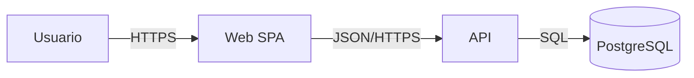

# Architecture Documentation

## Alcance
Plasmar arquitectura y decisiones. No cubre:
- Evaluar o decidir la arquitectura: `software-architecture`.
- Diseño de una función concreta: `technical-specification`.

## Procedimiento
1. Lee código, infraestructura y configuración. Dibuja lo que existe; separa "estado actual" de "objetivo".
2. Define los lectores y qué decisiones deben poder tomar.
3. Empieza con C4:
   - **Contexto**: sistema, usuarios y sistemas externos.
   - **Contenedores**: aplicaciones, bases de datos y colas.
   - **Componentes** y **Código**: solo si aportan valor. Para muchos equipos bastan los dos primeros.
   - Suplementarios: paisaje, dinámico y despliegue.
4. Usa diagramas como código, por ejemplo Mermaid, versionados junto al proyecto. Comprueba que se representen correctamente.
5. Da a cada diagrama título, leyenda y tipos de relación y protocolo.
6. Usa arc42 si se necesita una estructura completa.
7. Registra cada decisión relevante en un ADR: contexto, decisión, alternativas y consecuencias.
8. Indica fecha de revisión y responsable.

## ADR
- Una decisión por registro y numeración estable (`docs/adr/0007-…md`).
- No reescribas uno aceptado; crea otro que lo sustituya.
- Los motivos históricos desconocidos se marcan como "Motivo original desconocido".

## Reglas
- No inventes componentes, protocolos ni justificaciones históricas.
- No mezcles niveles de detalle en un mismo diagrama.
- Sin secretos ni direcciones internas sensibles en documentos compartidos.

## Verificación
Cada elemento del diagrama se corresponde con un artefacto real. Los diagramas se renderizan sin errores y un miembro del equipo los valida.

## Entrega
Diagramas, documento, ADR, supuestos, diferencias entre lo documentado y el código, y mantenimiento.

## Ejemplo

Sustituye elementos y protocolos por los verificados en el proyecto.

## Fuentes
Consulta `references/sources.md` cuando la tarea dependa de una versión, norma o comportamiento concreto, y confirma allí el dato antes de afirmarlo.
