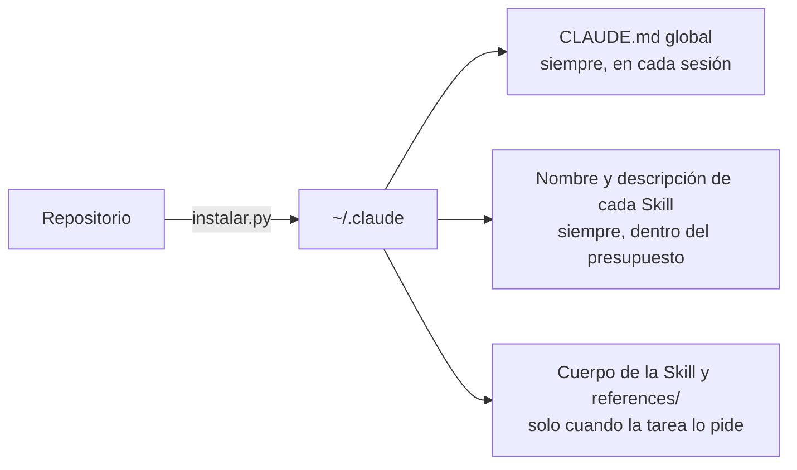

# Claude Software Engineering Skills

Colección de Skills personalizadas para el ciclo de vida del desarrollo de software con Claude y Claude Code, más las instrucciones generales que definen cómo trabaja Claude.

## Incluye

61 Skills en 7 especialidades. La lista completa, con su función y el número de fuentes, está en [docs/CATALOG.md](docs/CATALOG.md).

| Especialidad | Skills |
|---|---|
| Software Engineering | 9 |
| Development | 16 |
| Quality Assurance | 4 |
| Security | 8 |
| Cloud & Infrastructure | 7 |
| Documentation | 9 |
| Operations & Management | 8 |

Además, `global/CLAUDE.md` con las instrucciones generales (veracidad, investigación, uso de Skills, seguridad, estilo) y `global/ajustes.json` con la configuración que necesitan las Skills para verse bien en el listado.

## Estructura

```text
.claude/
  settings.json                  # presupuesto del listado para instalación por proyecto
  skills/<skill>/
    SKILL.md                     # instrucciones
    references/sources.md        # fuentes y estado de verificación
global/
  CLAUDE.md                      # se instala como ~/.claude/CLAUDE.md
  ajustes.json                   # se fusiona en ~/.claude/settings.json
docs/
  CATALOG.md                     # organización por especialidades
  instrucciones-maestras.md      # texto original y destino de cada sección
scripts/
  validate_skills.py             # validación estructural
  test_triggers.py               # prueba de activación (consume uso)
  instalar.py                    # instalación con respaldo
tests/trigger_cases.json         # casos de activación
CLAUDE.md                        # reglas para trabajar en este repositorio
CHANGELOG.md
```

Las carpetas de Skills son planas a propósito: Claude Code busca `.claude/skills/<skill>/SKILL.md` y no detecta subcarpetas por especialidad.

## Qué se carga y cuándo



Por eso las reglas generales están condensadas en `global/CLAUDE.md` (menos de 100 líneas) y los procedimientos largos viven en Skills.

## Instalación personal (todos tus proyectos)

```bash
git clone https://github.com/Isaac-saavedra/skills-claude.git
cd skills-claude
python3 scripts/instalar.py            # simulación: muestra qué cambiaría
python3 scripts/instalar.py --aplicar  # respalda e instala
```

El instalador:

1. Valida la biblioteca y no instala nada si hay errores.
2. Respalda `~/.claude/skills`, `CLAUDE.md`, `CLAUDE-omc.md` y `settings.json` en `~/.claude-respaldos/`.
3. Copia las Skills del repositorio. Solo retira las que una instalación anterior registró como propias; no toca `synced/` ni Skills de otras fuentes.
4. Instala `global/CLAUDE.md`. Si el actual tenía el bloque de oh-my-claudecode, lo guarda en `~/.claude/CLAUDE-omc.md`, que es lo que carga `omc launch`.
5. Fusiona `global/ajustes.json` en `~/.claude/settings.json` sin borrar el resto.

Reinicia Claude Code después de instalar. `global/CLAUDE.md` contiene preferencias personales: revísalo y adáptalo antes de instalarlo si no eres su autor.

### Instalación por proyecto

Copia `.claude/skills/` a la raíz del proyecto donde quieras que estén disponibles y versionadas.

## Actualizar

```bash
cd skills-claude
git pull
python3 scripts/instalar.py --aplicar
```

## Restaurar

Cada instalación deja un respaldo en `~/.claude-respaldos/claude-<fecha>.tar.gz`:

```bash
tar -tzf ~/.claude-respaldos/claude-<fecha>.tar.gz | head   # revisar el contenido
mv ~/.claude/skills ~/.claude/skills.descartado              # apartar la versión actual
tar -xzf ~/.claude-respaldos/claude-<fecha>.tar.gz -C ~/.claude
mv ~/.claude/skills.descartado/synced ~/.claude/skills/      # synced/ no va en el respaldo
```

## Presupuesto del listado de Skills

Claude Code envía en cada sesión el nombre y la descripción de todas las Skills. El espacio es una fracción de la ventana de contexto (`skillListingBudgetFraction`, por defecto 0,01, unos 8.000 caracteres con 200.000 tokens). Si el listado no cabe, recorta descripciones y Claude puede dejar de reconocer Skills.

Con estas 61 Skills, las oficiales de AWS, los plugins sincronizados y oh-my-claudecode, el listado ronda los 65.000 caracteres; por eso `global/ajustes.json` fija 0,09. Ajusta el valor a lo que tengas instalado y revisa el coste con `/doctor`.

`global/ajustes.json` también desactiva con `skillOverrides` las Skills de los plugins `engineering` y `design` que duplican a las de esta biblioteca. Vuelve a activarlas en `/skills` o quitando la clave.

## Subir Skills a Claude Web

Comprime cada carpeta de Skill por separado y súbela como Skill personalizada. La disponibilidad depende del plan y las capacidades habilitadas: consulta la documentación oficial vigente.

## Validación

```bash
python3 scripts/validate_skills.py          # estructura, metadatos, fuentes y catálogo
claude plugin validate .claude/skills       # requiere Claude Code 2.1.233 o posterior
python3 scripts/test_triggers.py            # activación real; consume uso de tu cuenta
```

`test_triggers.py` solo mira la primera acción del modelo, con el modelo por defecto de tu configuración. Si Claude empieza revisando archivos y usa la Skill después, cuenta como fallo: sirve para comparar versiones, no como medida absoluta.

## Verificación de la información

Cada Skill tiene `references/sources.md`, con la fecha de revisión y dos estados:

- **Leída**: se consultó el contenido para respaldar lo indicado.
- **Localizada**: la URL oficial se encontró, pero no se leyó su contenido.

Versiones, normas y servicios cambian. Las Skills indican consultar la fuente vigente en lugar de fijar versiones actuales. Revisa las fuentes periódicamente y actualiza la fecha.

## Compatibilidad

Estas Skills siguen la estructura de Agent Skills basada en `SKILL.md` y YAML frontmatter. La detección y disponibilidad pueden variar según el producto, versión y entorno de ejecución. Validar en cada entorno objetivo.

## Licencia

MIT. Revisa si esta licencia es adecuada antes de redistribuir o incorporar contenido de terceros.
